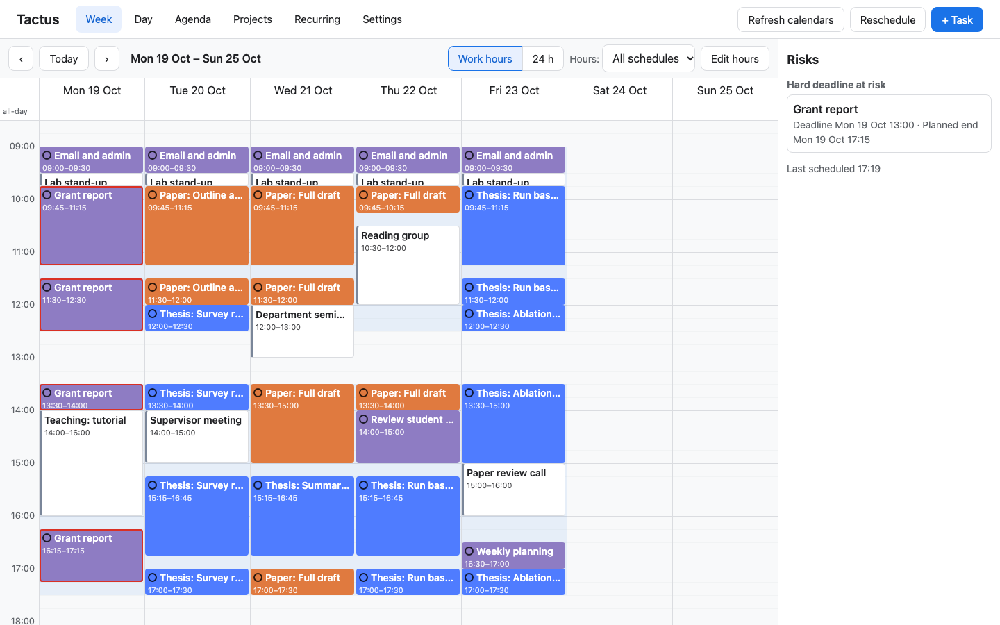
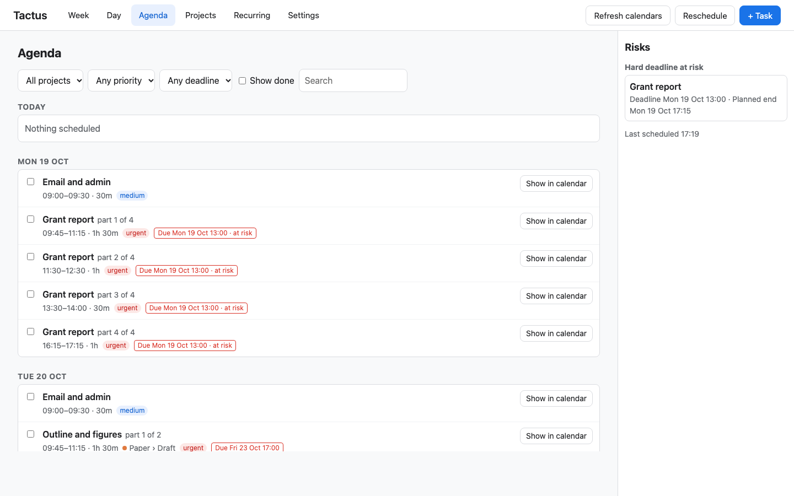
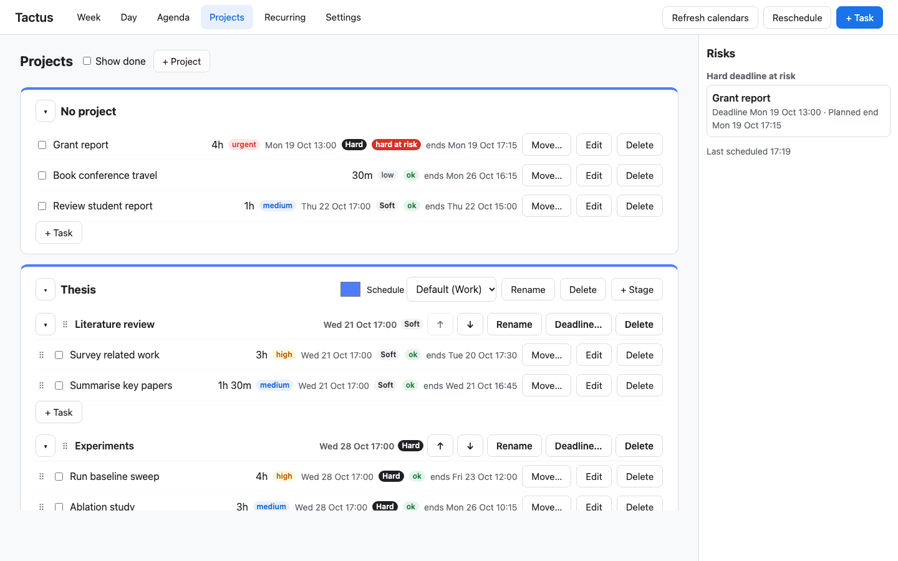

# Tactus

A self-hosted planner that schedules your tasks for you. Add tasks with durations and deadlines; Tactus places them
into the free time in your work hours, around the meetings in your calendars, and replans after every change.



## Features

- **Auto-scheduling** around calendar events, with priorities, hard and soft deadlines, breaks and lunch.
- **Deadline warnings**: the risk panel shows work that will miss its deadline before it happens.
- **Projects with stages**, task dependencies, and recurring tasks.
- **Week, day and agenda views**, with drag to move or resize planned blocks.
- **Any calendar**: reads Google, iCloud and Outlook through their ICS links. Read-only; it never edits your calendar.
- **Simple to run**: Node.js and SQLite, no build step, two npm dependencies.

## Quick start

Requires Node.js 22.13 or newer.

```sh
git clone https://github.com/kevin-y-yu/tactus.git
cd tactus
./run.sh
```

Open http://localhost:3200. Your data is stored in `data/tactus.db`, and `./run.sh` backs it up on every start.

## Screenshots

| Agenda | Projects |
|---|---|
|  |  |

## Configuration

Set environment variables, or copy `.env.example` to `.env`.

| Variable | Default | Meaning |
|---|---|---|
| `PORT` | `3200` | HTTP port |
| `HOST` | `127.0.0.1` | Bind address |
| `DATA_DIR` | `./data` | Where the database lives |
| `AUTH_TOKEN` | unset | Set this to require a login, for example when hosting it |

Everything else (work hours, calendars, scheduling rules, timezone) is set in the app under Settings.

## Learn more

- [User guide](docs/guide.md): every feature, linking calendars, hosting and limitations.
- `./run.sh test` runs the test suite.

## Licence

MIT, see [LICENSE](LICENSE). Third-party notices are in [THIRD_PARTY_NOTICES.md](THIRD_PARTY_NOTICES.md).
